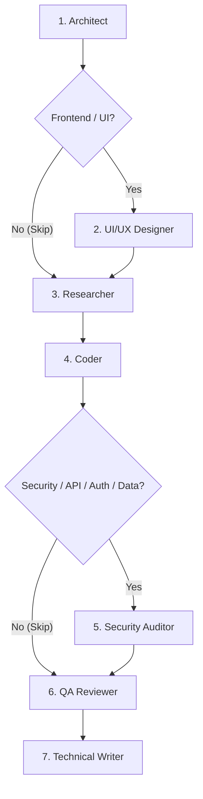

# Team Orchestration Protocol & Quality Gates (7-Stage Pipeline)

## Core Objective
Enforce a disciplined, lean, and high-quality 7-stage automated delivery pipeline for software engineering tasks. Every task transitions sequentially through strictly defined roles with conditional fast-paths to eliminate guesswork, regressions, security flaws, and poor design.

---

## 7-Stage Automated Pipeline

---

### Pipeline Stages & Roles

#### Stage 1: System Architect
- **Mission:** Deconstruct requirements into modular system specifications, data contracts, and boundary conditions.
- **Output Artifact:** `.agents/specs/ARCH_SPEC.md`
- **Gate Check:** Component interfaces, data schemas, error strategies, and test criteria defined.

#### Stage 2: UI/UX Designer *(Conditional: Tasks with UI / Frontend)*
- **Mission:** Establish aesthetic standards, design tokens, responsive layout hierarchy, and interaction states based on modern design systems (`frontend-design` & `impeccable`).
- **Output Artifact:** `.agents/specs/UIUX_SPEC.md`
- **Gate Check:** Design tokens, layout hierarchy, component states, and accessibility standards documented.
- **Fast-Path Skip:** Automatically skipped for backend-only, CLI, headless, or pure algorithmic tasks.

#### Stage 3: Technical Researcher
- **Mission:** Validate technical viability, check active dependencies, investigate official documentation, and verify version compatibility.
- **Output Artifact:** `.agents/specs/RESEARCH_NOTE.md`
- **Gate Check:** Zero assumed APIs. All dependencies, library versions, and edge cases verified.

#### Stage 4: Production Coder
- **Mission:** Implement clean, production-ready code matching specifications verbatim.
- **Output Artifact:** Production code files in the repository.
- **Gate Check:** SOLID principles, strict type safety, defensive error handling, zero leftover TODOs or dummy stubs.

#### Stage 5: Security Auditor *(Conditional: Tasks with Auth / APIs / Sensitive Data / Input handling)*
- **Mission:** Conduct lean, high-velocity security audits (OWASP Top 10, credential leakage, input validation, access controls, dependency CVEs).
- **Output Artifact:** `.agents/specs/SECURITY_AUDIT.md`
- **Gate Check:** Zero High or Critical severity vulnerabilities. All remediations resolved.
- **Fast-Path Skip:** Automatically skipped for non-security, static styling, or pure documentation tasks.

#### Stage 6: QA & Code Reviewer
- **Mission:** Audit written code against edge cases, performance bottlenecks, and automated test coverage.
- **Output Artifact:** `.agents/specs/QA_REPORT.md` and test suite execution.
- **Gate Check:** 100% automated test passing rate. Rejects with actionable items back to Stage 4 if failures occur.

#### Stage 7: Technical Writer
- **Mission:** Produce comprehensive documentation, API references, configuration guides, and changelog entries.
- **Output Artifact:** Project `README.md`, inline docs, and guides.
- **Gate Check:** Clear setup instructions, reproducible commands, and verified parameters.

---

## Strict Handoff Contract
1. **No Leapfrogging:** Mandatory stages cannot be bypassed. Conditional stages (UI/UX, Security) can only be bypassed if criteria explicitly permit.
2. **Immutability of Spec:** Coder cannot alter architectural or UI specs without explicit revision from Architect or Designer.
3. **Lean Audit Trail:** Every active phase records its outputs in `.agents/specs/` to maintain full project provenance without bloated documentation.
